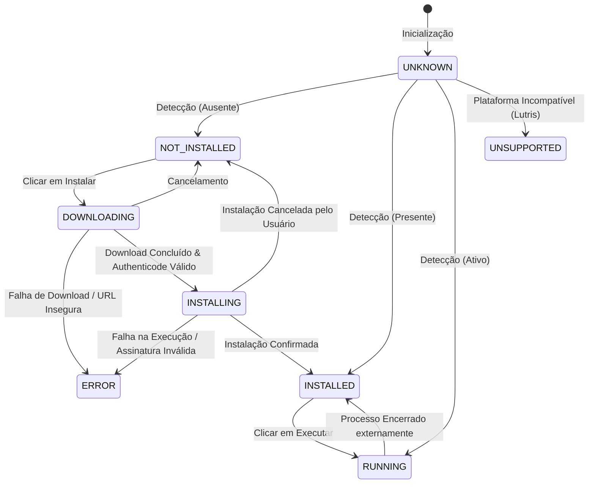
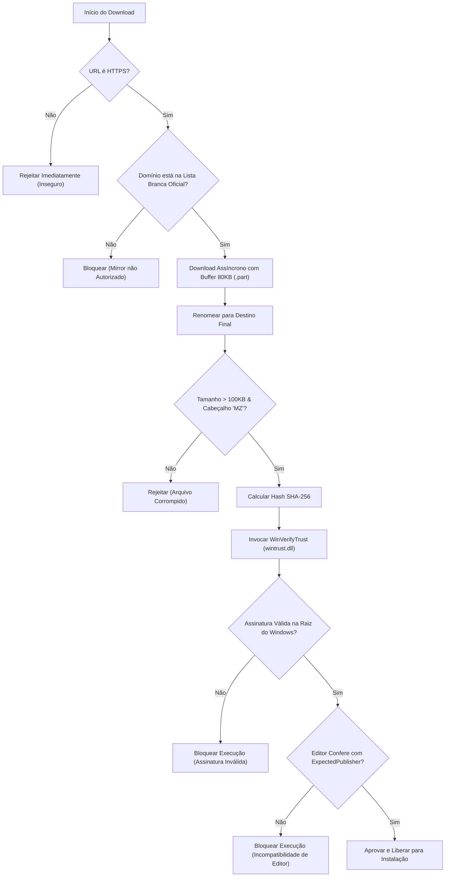

# Arquitetura e Engenharia de Software — GameLauncher Hub

Este documento descreve a fundamentação técnica, decisões arquiteturais e padrões de projeto adotados no **GameLauncher Hub**.

---

## 1. Princípios Fundamentais

A arquitetura foi projetada com base nos princípios de **Clean Architecture**, **SOLID** e **Secure by Design**:

1. **Separação de Responsabilidades:** A interface gráfica (WPF) não contém regras de negócio ou chamadas diretas a APIs do sistema operacional; toda a comunicação ocorre via ViewModels reativos e interfaces de serviço.
2. **Inversão de Dependência (DIP):** Módulos de alto nível dependem de abstrações (interfaces do `GameLauncherHub.Domain`), desacoplando a infraestrutura do núcleo da aplicação.
3. **Aberto/Fechado (OCP):** Novos mecanismos de detecção de instaladores ou launchers podem ser adicionados implementando a interface `IDetectionStrategy` sem necessidade de alterar o serviço central `LauncherDetectionService`.
4. **Resiliência e Assincronismo:** Todas as operações de I/O (leitura de registro, downloads de rede, cálculo de hashes e monitoramento de processos) utilizam `async/await` com propagação de `CancellationToken`, garantindo 100% de responsividade na interface com o usuário.

---

## 2. Camadas da Solução

### `GameLauncherHub.Domain`
O núcleo agnóstico da aplicação:
- **`Enums`:**
  - `LauncherState`: `NOT_INSTALLED`, `INSTALLED`, `INSTALLING`, `DOWNLOADING`, `RUNNING`, `ERROR`, `UNSUPPORTED`, `UNKNOWN`.
  - `OperationType`: `Detection`, `Download`, `SignatureVerification`, `Installation`, `Execution`.
- **`Models`:**
  - `LauncherPlatform`: Entidade rica com dados de identidade visual, fontes oficiais e blocos de regras (`DetectionRules`, `ExecutionRules`, `InstallationRules`).
  - `OperationLog`: Modelo de auditoria com timestamp, editor, operação, resultado e detalhes.
  - `AppSettings`: Modelo de preferências persistidas.
- **`Interfaces`:** Contratos fundamentais (`ICatalogService`, `ILauncherDetectionService`, `ILauncherExecutionService`, `IDownloadManager`, `IInstallerService`, `IInstallerSecurityService`, `ISettingsService`, `IOperationHistoryService`).

### `GameLauncherHub.Application`
Coordena o fluxo de casos de uso da aplicação:
- **`LauncherOrchestratorService`:** Orquestrador central assíncrono.
  - Executa detecção paralela ao inicializar.
  - Sincroniza download, validação Authenticode, elevação de instalador e re-varredura.
  - Dispara eventos `PlatformStateChanged` para notificação em tempo real da interface.

### `GameLauncherHub.Infrastructure`
Implementação concreta dos contratos utilizando APIs nativas do Windows e .NET:
- **`Catalog`:** `CatalogService` que realiza a carga a partir de `catalog.json` com suporte a extensões em `%LOCALAPPDATA%\GameLauncherHub\custom_catalog.json`.
- **`Detection`:** Motor multi-estratégia (`RegistryUninstallDetectionStrategy`, `AppPathsDetectionStrategy`, `ProtocolRegistrationDetectionStrategy`, `KnownPathsDetectionStrategy`, `StartMenuDetectionStrategy`, `WindowsStorePackageDetectionStrategy`, `ProcessDetectionStrategy`).
- **`Downloads`:** `HttpDownloadManager` com buffer de 80 KB assíncrono, cálculo de vazão (KB/s / MB/s) e descarte automático de arquivos `.part` em cancelamentos.
- **`Security`:** `InstallerSecurityService` e `AuthenticodeVerifier` realizando chamadas P/Invoke para a API `WinVerifyTrust` em `wintrust.dll` e extração de certificados X.509 embutidos no binário.
- **`Services`:** `LauncherExecutionService`, `InstallerService`, `SettingsService` e `OperationHistoryService`.

### `GameLauncherHub.UI`
Camada de apresentação moderna desenvolvida em WPF:
- **MVVM com CommunityToolkit.Mvvm:** `MainViewModel`, `LauncherCardViewModel`, `SettingsViewModel`, `HistoryViewModel`.
- **Design System:** Estilos desacoplados em `Resources/Themes/DarkTheme.xaml`, `Resources/Themes/Icons.xaml` e `Resources/Styles/Controls.xaml`.
- **Custom Chrome:** Utilização de `WindowChrome` para oferecer bordas limpas e barra de controle integrada ao tema grafite escuro.
- **Conversores de Valor (ValueConverters):** Transformam estados operacionais em cores, badges e textos descritivos sem poluir as ViewModels com tipos de UI.

---

## 3. Máquina de Estados Operacional

---

## 4. Pipeline de Segurança de Instaladores

